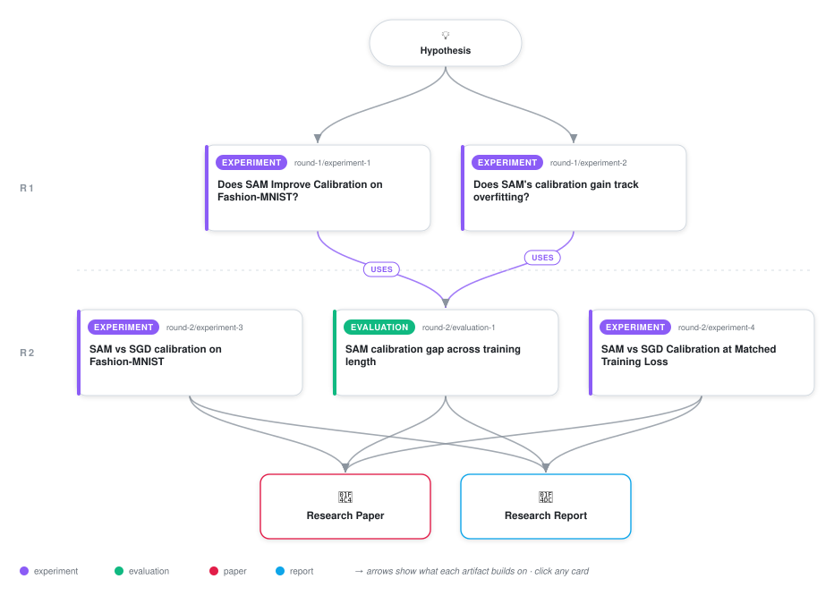

# Sharpness-Aware Minimization and Test NLL Beyond Temperature Scaling on Fashion-MNIST

<div align="center">

<a href="https://cdn.jsdelivr.net/gh/ai-inventor-papers/ai-invention-d46016-sharpness-aware-training-makes-small@main/workflow.svg">
<picture>
  <source media="(prefers-color-scheme: dark)" srcset="workflow-dark.svg">
  
</picture>
</a>

<sub>🖱️ <b><a href="https://cdn.jsdelivr.net/gh/ai-inventor-papers/ai-invention-d46016-sharpness-aware-training-makes-small@main/workflow.svg">Open the interactive diagram</a></b> — every card links to its artifact folder.</sub>

</div>

> **TL;DR** — On a small convolutional network trained on Fashion-MNIST, SAM has a lower test negative log-likelihood than validation-tuned SGD after both models are temperature-scaled: 0.033 lower (95% CI -0.040 to -0.026; Holm-corrected p = 0.0018). This is a single tuned estimate over five paired seeds, not specified in advance and not reproduced independently, so it is a lead rather than a confirmed result. Shuffled-label controls give larger NLL gaps than the real comparison, against raw SGD and, post hoc, against temperature-scaled SGD, so they do not show that the advantage reflects learned label information. SAM's lower raw ECE disappears once SGD is temperature-scaled, and its accuracy advantage holds at the tuned SGD learning rate but not at 0.01.

<details>
<summary>Full hypothesis</summary>

For a small two-block CNN trained on Fashion-MNIST with matched architecture, data, schedule and tuned learning rates, sharpness-aware minimization (SAM) gives lower test negative log-likelihood than plain SGD, and this NLL gain survives temperature scaling of the SGD model fitted on validation logits, so it reflects better ranking of confidence rather than a global confidence shift. SAM's raw test ECE advantage does not survive that control: against temperature-scaled SGD the ECE difference is indistinguishable from zero. Test accuracy is unchanged within seed noise. Whether the NLL gain holds at matched training loss and with learning rates away from the lower grid edge is not yet established and is the next test.

</details>

[](https://ai-inventor-papers.github.io/ai-invention-d46016-sharpness-aware-training-makes-small/) [](https://ai-inventor-papers.github.io/ai-invention-d46016-sharpness-aware-training-makes-small/interactive.html)

[](https://cdn.jsdelivr.net/gh/ai-inventor-papers/ai-invention-d46016-sharpness-aware-training-makes-small@main/paper.pdf) [](https://cdn.jsdelivr.net/gh/ai-inventor-papers/ai-invention-d46016-sharpness-aware-training-makes-small@main/report.pdf) [](https://cdn.jsdelivr.net/gh/ai-inventor-papers/ai-invention-d46016-sharpness-aware-training-makes-small@main/exec_summary.pdf) [](https://cdn.jsdelivr.net/gh/ai-inventor-papers/ai-invention-d46016-sharpness-aware-training-makes-small@main/round-2/report.pdf) [](https://github.com/ai-inventor-papers/ai-invention-d46016-sharpness-aware-training-makes-small/tree/main/paper_latex)

**Round reports:** [Round 1](https://cdn.jsdelivr.net/gh/ai-inventor-papers/ai-invention-d46016-sharpness-aware-training-makes-small@main/round-1/report.pdf) · [Round 2](https://cdn.jsdelivr.net/gh/ai-inventor-papers/ai-invention-d46016-sharpness-aware-training-makes-small@main/round-2/report.pdf)

This repository contains all **5 artifacts** produced across **2 rounds** of an autonomous AI research run — round by round, exactly in the order they were invented.

## Round 1

| Artifact | Type | Demo | Source | Builds on |
|----------|------|------|--------|-----------|
| **[Does SAM Improve Calibration on Fashion-MNIST?](https://github.com/ai-inventor-papers/ai-invention-d46016-sharpness-aware-training-makes-small/tree/main/round-1/experiment-1)** | [](https://github.com/ai-inventor-papers/ai-invention-d46016-sharpness-aware-training-makes-small/tree/main/round-1/experiment-1) | [](https://colab.research.google.com/github/ai-inventor-papers/ai-invention-d46016-sharpness-aware-training-makes-small/blob/main/round-1/experiment-1/demo/method_code_demo.ipynb) | [](https://github.com/ai-inventor-papers/ai-invention-d46016-sharpness-aware-training-makes-small/tree/main/round-1/experiment-1/src) | — |
| **[Does SAM's calibration gain track overfitting?](https://github.com/ai-inventor-papers/ai-invention-d46016-sharpness-aware-training-makes-small/tree/main/round-1/experiment-2)** | [](https://github.com/ai-inventor-papers/ai-invention-d46016-sharpness-aware-training-makes-small/tree/main/round-1/experiment-2) | [](https://colab.research.google.com/github/ai-inventor-papers/ai-invention-d46016-sharpness-aware-training-makes-small/blob/main/round-1/experiment-2/demo/method_code_demo.ipynb) | [](https://github.com/ai-inventor-papers/ai-invention-d46016-sharpness-aware-training-makes-small/tree/main/round-1/experiment-2/src) | — |

## Round 2

| Artifact | Type | Demo | Source | Builds on |
|----------|------|------|--------|-----------|
| **[SAM vs SGD calibration on Fashion-MNIST](https://github.com/ai-inventor-papers/ai-invention-d46016-sharpness-aware-training-makes-small/tree/main/round-2/experiment-3)** | [](https://github.com/ai-inventor-papers/ai-invention-d46016-sharpness-aware-training-makes-small/tree/main/round-2/experiment-3) | [](https://colab.research.google.com/github/ai-inventor-papers/ai-invention-d46016-sharpness-aware-training-makes-small/blob/main/round-2/experiment-3/demo/method_code_demo.ipynb) | [](https://github.com/ai-inventor-papers/ai-invention-d46016-sharpness-aware-training-makes-small/tree/main/round-2/experiment-3/src) | — |
| **[SAM vs SGD Calibration at Matched Training Loss](https://github.com/ai-inventor-papers/ai-invention-d46016-sharpness-aware-training-makes-small/tree/main/round-2/experiment-4)** | [](https://github.com/ai-inventor-papers/ai-invention-d46016-sharpness-aware-training-makes-small/tree/main/round-2/experiment-4) | [](https://colab.research.google.com/github/ai-inventor-papers/ai-invention-d46016-sharpness-aware-training-makes-small/blob/main/round-2/experiment-4/demo/method_code_demo.ipynb) | [](https://github.com/ai-inventor-papers/ai-invention-d46016-sharpness-aware-training-makes-small/tree/main/round-2/experiment-4/src) | — |
| **[SAM calibration gap across training length](https://github.com/ai-inventor-papers/ai-invention-d46016-sharpness-aware-training-makes-small/tree/main/round-2/evaluation-1)** | [](https://github.com/ai-inventor-papers/ai-invention-d46016-sharpness-aware-training-makes-small/tree/main/round-2/evaluation-1) | [](https://colab.research.google.com/github/ai-inventor-papers/ai-invention-d46016-sharpness-aware-training-makes-small/blob/main/round-2/evaluation-1/demo/eval_code_demo.ipynb) | [](https://github.com/ai-inventor-papers/ai-invention-d46016-sharpness-aware-training-makes-small/tree/main/round-2/evaluation-1/src) | <sub><i>uses:</i><br/>[experiment‑1&nbsp;(R1)](https://github.com/ai-inventor-papers/ai-invention-d46016-sharpness-aware-training-makes-small/tree/main/round-1/experiment-1)<br/>[experiment‑2&nbsp;(R1)](https://github.com/ai-inventor-papers/ai-invention-d46016-sharpness-aware-training-makes-small/tree/main/round-1/experiment-2)</sub> |

## Repository Structure

Artifacts are grouped by the round of invention that produced them. Each
artifact has its own folder with source code and a self-contained demo:

```
.
├── round-1/                         # One folder per round of invention
│   ├── experiment-1/
│   │   ├── README.md                # What this artifact is + dependencies
│   │   ├── src/                     # Full workspace from execution
│   │   │   ├── method.py            # Main implementation
│   │   │   ├── method_out.json      # Full output data
│   │   │   └── ...                  # All execution artifacts
│   │   └── demo/                    # Self-contained demo
│   │       └── method_code_demo.ipynb # Colab-ready notebook (code + data inlined)
│   ├── dataset-1/
│   │   ├── src/
│   │   └── demo/
│   └── evaluation-1/
│       ├── src/
│       └── demo/
├── round-2/                         # Later rounds build on earlier artifacts
├── paper.pdf                        # Research paper
├── paper_latex/                     # LaTeX source files
├── report.pdf                       # Full internal report — every experiment, table and dead end
├── report_latex/                    # LaTeX source of the report
├── exec_summary.pdf                 # Executive summary of the report, at most four pages
├── chat/                            # Every prompt, response and tool call, per module
├── workflow.svg                     # Artifact dependency diagram (this page's header)
└── README.md
```

## Running Notebooks

### Option 1: Google Colab (Recommended)

Click the "Open in Colab" badges above to run notebooks directly in your browser.
No installation required!

### Option 2: Local Jupyter

```bash
# Clone the repo
git clone https://github.com/ai-inventor-papers/ai-invention-d46016-sharpness-aware-training-makes-small
cd ai-invention-d46016-sharpness-aware-training-makes-small

# Install dependencies
pip install jupyter

# Run any artifact's demo notebook
jupyter notebook <artifact_folder>/demo/
```

## Source Code

The original source files are in each artifact's `src/` folder.
These files may have external dependencies - use the demo notebooks for a self-contained experience.

---
*Generated by AI Inventor Pipeline - Automated Research Generation*
